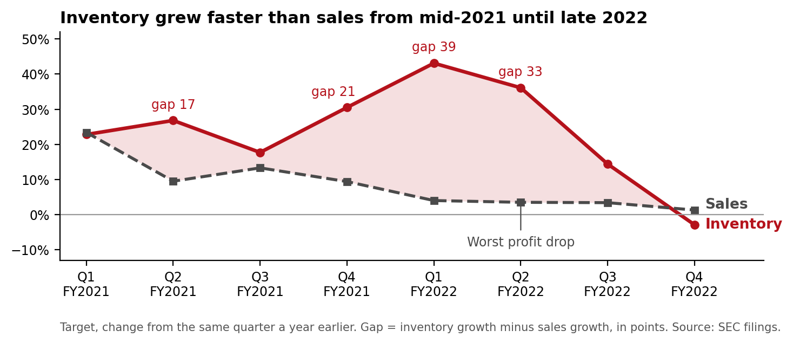

# Why did Target's profit fall while revenue grew? (Fiscal 2022)

**Real, public data:** SEC filings for Target, Walmart and Kohl's, with price data from the Bureau of Labor Statistics and store sales from the Census Bureau.



## The question

It's early 2023. Target's revenue grew 2.9% last year, but its operating income fell by more than half. Why, and what should the CEO do about it?

| Operating income | Cost-of-goods rate | Q2 share of the drop | Operating margin |
|:-:|:-:|:-:|:-:|
| **−57%** ($8.95B → $3.85B) | **$5.06B** of the $5.10B drop | **42%** | Target **−4.9** points, Kohl's −7.3, Walmart −1.2 |

📄 **[One-page brief (PDF)](docs/brief.pdf)** · [Markdown](docs/brief.md)

## What this shows

- **Profit fell because the cost of goods jumped.** That line also includes markdowns, freight, theft and loss, and distribution costs, so it doesn't mean products simply cost more.
- **Excess inventory cleared with discounts best explains the Q2 spike,** and is one of several causes over the full year.
- **The inventory build-up began in 2021.** It used $3.2B of cash that year. Demand then moved: Target's Discretionary sales fell 3.4% in 2022 while everyday categories grew 10.3%.
- **It wasn't only Target.** Margins fell at all three companies.

## Recommendations

1. **Watch the gap between stock and sales.** Above 10 points, look at why. Above 15, review before placing new Discretionary orders. The levels come from Target's own history: its gap never passed 12.2 in 43 quarters before the pandemic.
2. **Commit to less Discretionary stock up front,** especially owned brands.
3. **Show what each cause cost, every quarter.** Target's annual report names the causes but doesn't size them.

[What happened next](docs/07-what-happened-next.md) grades the brief against filings through August 2026, including what it underrated: running costs.

## How I checked the numbers

- **Against the annual report:** revenue, cost of goods, SG&A, depreciation and operating income match Target's FY2022 10-K exactly.
- **Inside the data:** costs add up to operating income in every quarter where all lines are reported (Target 14, Walmart 20, Kohl's 12), and the four quarters add up to the annual figure within $2M.
- **The profit breakdown adds up exactly** to the change in operating income.
- **Reproducible:** rerunning the cleaning and analysis scripts gives identical output.

## Limits

- **It can't split the drop by cause,** prove that discounting caused it, or estimate savings. Public filings don't give the amounts.
- **It isn't blind.** Markdowns and freight were known as likely causes, and some later results had been seen, before the analysis.
- **It isn't purely a March 2023 view.** The SEC figures are, but the BLS and Census figures may include later revisions.
- **Two peers show direction, not an industry average.** Walmart's result may include a one-off charge.

Corrections made along the way are kept in the notes below.

## The work, step by step

| Step | Notes | Code |
|---|---|---|
| Questions | [Framing](docs/01-questions.md) | – |
| Data | [Profile and hypotheses](docs/02-data-profile.md) | `src/load_facts.py`, `src/profile_facts.py` |
| Cleaning | [Rules and checks](docs/03-cleaning.md) | `src/clean_quarterly.py` |
| Analysis | [Findings](docs/04-analysis.md) | `src/explore.py` |
| Validation | [Against Target's 10-K](docs/05-validation.md) | – |
| Recommendations | [Actions and trigger levels](docs/06-recommendations.md) | `src/gap_backtest.py`, `src/gap_history.py` |
| Brief | [One page](docs/brief.md) | `src/make_brief.py` (needs Google Chrome) |
| Epilogue | [What happened next](docs/07-what-happened-next.md) | `src/epilogue.py` |

**To run it:** `python3 -m venv .venv && .venv/bin/pip install -r requirements.txt`, then:

```
.venv/bin/python src/load_facts.py data/raw data/interim/facts_long.csv
.venv/bin/python src/clean_quarterly.py data/interim/facts_long.csv data/clean/quarterly.csv
.venv/bin/python src/explore.py
.venv/bin/python src/gap_backtest.py
.venv/bin/python src/gap_history.py
.venv/bin/python src/make_brief.py
.venv/bin/python src/epilogue.py
```

**Tools:** Python (pandas, matplotlib).

**Sources:** [SEC company facts](https://www.sec.gov/search-filings/edgar-application-programming-interfaces) · [Target filings](https://www.sec.gov/edgar/browse/?CIK=27419) · [BLS](https://www.bls.gov/data/) · [Census monthly retail trade](https://www.census.gov/retail/). The CEO-brief format was inspired by a LinkedIn Learning course.

**Author:** Nicolette Mtisi. Not affiliated with Target, Walmart or Kohl's.
