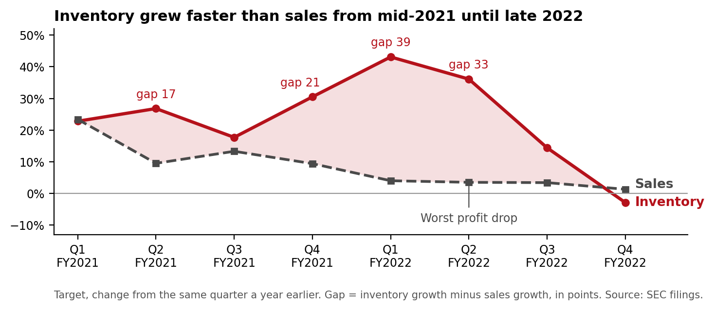

# Why Target's profit fell while revenue grew

**Profit fell because the cost of goods jumped, and inventory decisions that began in 2021 left Target more exposed.** *The first half is measured. The second half is our judgment.*

## What happened

In fiscal 2022 revenue rose 2.9% to $109.1B, but operating income fell 57%, from $8.95B to $3.85B. Almost all of the drop came from the cost-of-goods rate, which includes markdowns, freight, theft and loss, and distribution costs.

| Higher sales | Cost-of-goods rate | SG&A rate | Depreciation rate | **Change in operating income** |
|:-:|:-:|:-:|:-:|:-:|
| +$0.26B | **−$5.06B** | −$0.33B | +$0.03B | **−$5.10B** |

## Why

- **Q2 was the worst quarter, with 42% of the drop.** Excess inventory cleared with discounts best explains that spike, and is one of several causes over the full year.
- **The build-up began in 2021.** Inventory used $3.2B of cash that year. In 2022 demand moved: Discretionary sales fell 3.4% while everyday categories grew 10.3%.
- **Costs stayed high after inventory growth stopped.** In Q4 the cost rate was still 2.8 points above the prior year. The 10-K also names freight and merchandise costs, distribution costs and theft and loss.

## Just Target?

No. Operating margin fell at all three companies: Kohl's −7.3 points, **Target −4.9**, Walmart −1.2 (which may include a one-off charge). Two peers show direction, not an industry average.

## What to do

1. **Watch the gap between stock and sales.** If stock grows more than 10 points faster than sales, look at why, by category. Above 15, review before placing new Discretionary orders. Before the pandemic, Target's gap never passed 12.2 in 43 quarters. It prompts questions and doesn't predict: Walmart passed 15 and its cost rate rose only about 1 point.
2. **Commit to less Discretionary stock up front,** in smaller amounts and later, especially owned brands. The trade-off is possibly higher unit costs or some items running out.
3. **Show what each cause cost, every quarter.** The 10-K names the causes but doesn't size them. Check what Target already tracks first.

## What we can't say

We can't split the drop by cause, prove that discounting caused it, or estimate what these actions would save. For scale, one point of cost rate is about $1.1B.

---

*Nicolette Mtisi. Portfolio case study, not affiliated with Target. Written as of early 2023 from SEC filings made by March 31, 2023, but not blind: some causes and later results were known beforehand.*
